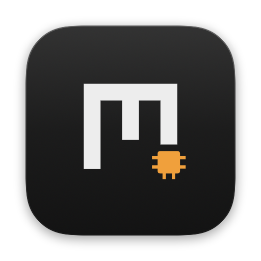
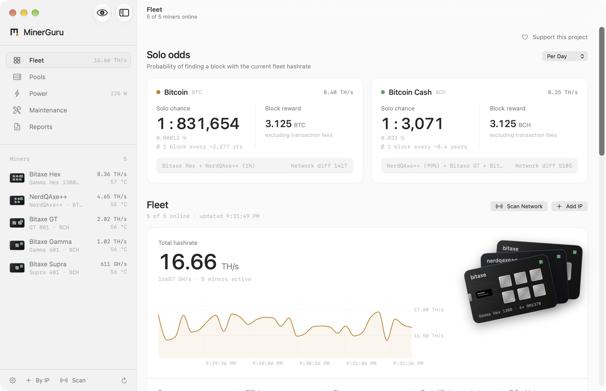
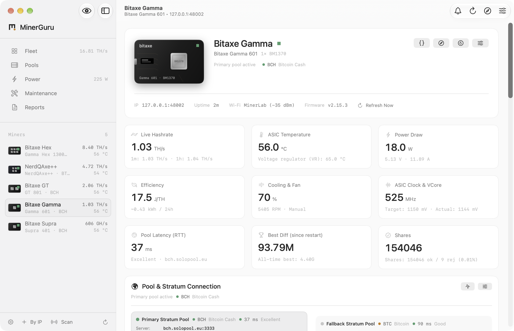
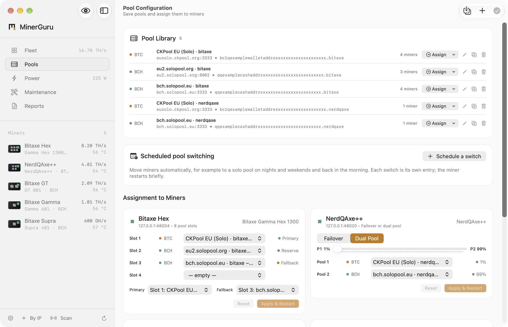

<p align="center">
  
</p>

<h1 align="center">MinerGuru for Mac</h1>

<p align="center">
  <b>The most beautiful app for your Bitaxe and NerdQAxe miners.</b><br>
  Find them, watch them, tune them, right from your menu bar.
</p>

<p align="center">
  <a href="https://github.com/GuruMeditationSoftware/minerguru/releases/latest/download/MinerGuru.dmg"><b>Download for Mac</b></a>
  &nbsp;·&nbsp;
  <a href="https://github.com/GuruMeditationSoftware/minerguru-android">Android</a>
  &nbsp;·&nbsp;
  <a href="https://github.com/GuruMeditationSoftware/minerguru-windows">Windows</a>
  &nbsp;·&nbsp;
  <a href="https://minerguru.github.io">Website</a>
</p>

<p align="center">
  <sub>macOS 14 or later · Apple Silicon · Free · Open source · No account</sub>
</p>

<p align="center">
  <picture>
    <source media="(prefers-color-scheme: dark)" srcset=".github/readme/overview-dark.png">
    
  </picture>
</p>

MinerGuru talks to AxeOS and NerdOS directly over your local network. No cloud in between, no account, no tracking: just your miners and a native Mac app that shows everything they report.

## Features

- **Finds your miners.** Scans your network in seconds, or add a miner by IP address or hostname.
- **Live fleet dashboard.** Total hashrate with its history, power, efficiency in J/TH, shares, best difficulty and pool latency.
- **Always in sight.** Your fleet hashrate in the menu bar, with quick access to every miner.
- **Tune and control.** Frequency, core voltage and fan for Eco, Standard and Boost. Restart or rename in a click. Overclocking is always at your own risk.
- **Pool management.** A pool library, assignment to every slot of every miner, a latency test before you switch, and scheduled switching, for example to a solo pool at night.
- **Solo mining odds.** Your chance of finding a block per day, month or year, for BTC and BCH.
- **Alerts.** When a miner goes offline, overheats, stops finding shares, falls back to its backup pool or its payout address changes. Also by email through your own mail server.
- **History and reports.** Every minute for two weeks, hourly for three years, stored locally. Reports on uptime, energy and cost as PDF or CSV.
- **Maintenance.** Plan fan cleaning, thermal paste and firmware checks, and get a reminder when they are due.
- **Widgets.** Fleet, single miner, solo odds and power on the desktop and in Notification Center. On macOS 26, Control Center gets a night mode and a switch to mute alerts.
- **Safe by default.** A read-only mode, a local log of every change, and an optional automatic restart at most once an hour.
- **Private by design.** Once a day MinerGuru asks GitHub for a new version, and you can turn that off. Hide addresses for screenshots with one shortcut.

Works with every miner running AxeOS or NerdOS, including Bitaxe Max, Ultra, Supra, Gamma, GT and Hex, NerdAxe, NerdQAxe and NerdOctaxe. Board, chip count and ASIC are detected automatically.

<table>
  <tr>
    <td width="50%">
      <picture>
        <source media="(prefers-color-scheme: dark)" srcset=".github/readme/miner-dark.png">
        
      </picture>
    </td>
    <td width="50%">
      <picture>
        <source media="(prefers-color-scheme: dark)" srcset=".github/readme/pools-dark.png">
        
      </picture>
    </td>
  </tr>
  <tr>
    <td align="center"><sub>One miner in detail</sub></td>
    <td align="center"><sub>Pools for the whole fleet</sub></td>
  </tr>
</table>

## Download and install

**[Download MinerGuru.dmg](https://github.com/GuruMeditationSoftware/minerguru/releases/latest/download/MinerGuru.dmg)** · macOS 14 or later · Apple Silicon

1. Open the DMG and drag MinerGuru into Applications.
2. Start MinerGuru from Applications. It is not notarized by Apple, so macOS asks you to confirm the first start: click **Done**, open **System Settings → Privacy & Security**, scroll down and click **Open Anyway**.

Every release lists its SHA-256 checksum in `SHA256SUMS.txt`. What changed: [Releases](https://github.com/GuruMeditationSoftware/minerguru/releases).

## MinerGuru on your other devices

| Platform | Requirements | Download |
| --- | --- | --- |
| **Mac** (this repository) | macOS 14 or later, Apple Silicon | [MinerGuru.dmg](https://github.com/GuruMeditationSoftware/minerguru/releases/latest/download/MinerGuru.dmg) |
| [**Android**](https://github.com/GuruMeditationSoftware/minerguru-android) | Android 12 or later | [MinerGuru.apk](https://github.com/GuruMeditationSoftware/minerguru-android/releases/latest/download/MinerGuru.apk) |
| [**Windows**](https://github.com/GuruMeditationSoftware/minerguru-windows) | Windows 11, x64 or Arm | [x64](https://github.com/GuruMeditationSoftware/minerguru-windows/releases/latest/download/MinerGuru-x64.exe) · [Arm64](https://github.com/GuruMeditationSoftware/minerguru-windows/releases/latest/download/MinerGuru-arm64.exe) |

## Build from source

You need macOS 14 or later and Xcode 26 or later.

```bash
git clone https://github.com/GuruMeditationSoftware/minerguru.git MinerGuru
```

```bash
cd MinerGuru && open MinerGuru.xcodeproj
```

In Xcode, ⌘R runs the app and ⌘U runs the tests. From the command line:

```bash
swift test                          # unit tests
scripts/make-dmg.sh                 # universal release build, signed ad hoc: dist/MinerGuru-<version>.dmg
MockMiners/run-app-with-mocks.sh    # a separate "MinerGuru (Mock)" with simulated miners of every model
```

The simulated miners in `MockMiners/` behave like the real firmware, so you can work on MinerGuru without any hardware. They serve the Android and Windows apps too.

Developer documentation, in German: [docs/ENTWICKLUNG.md](docs/ENTWICKLUNG.md) (build, test, project layout), [docs/ARCHITEKTUR.md](docs/ARCHITEKTUR.md) (the Mac app) and [docs/GRUNDLAGEN.md](docs/GRUNDLAGEN.md) (miner API, polling, write path: what all three apps share).

## Support the project

MinerGuru is free and shows no ads. If it keeps your miners happy, a few sats keep the updates coming.

<table>
  <tr>
    <td align="center"><br><b>Bitcoin</b></td>
    <td align="center"><br><b>Bitcoin Cash</b></td>
  </tr>
</table>

**BTC**

```text
bc1qc6xpuwkys8jsjt439tfw2eu3fctkx7ad0hkehe
```

**BCH**

```text
bitcoincash:qruvqq2x9vyd9gykre058r4lda4gulpres33nr9aml
```

## Feedback and contributing

Found a bug or have an idea? Open an [issue](https://github.com/GuruMeditationSoftware/minerguru/issues) in the Mac repository. It collects feedback for all three apps. Pull requests are welcome, see [CONTRIBUTING.md](CONTRIBUTING.md).

## License

MinerGuru is open source under the [MIT License](LICENSE.txt).
