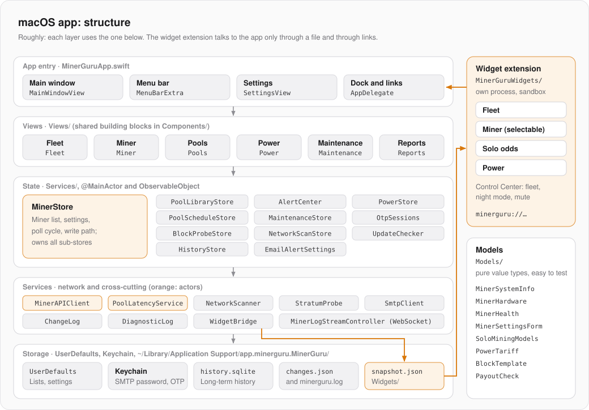

# macOS app: architecture

What all three apps have in common (miner API, poll cycle, write path, watchdog, mock miners) is in [FUNDAMENTALS.md](FUNDAMENTALS.md). This page describes only the Mac app.

| | |
|---|---|
| Language, UI | Swift 6 (strict concurrency), SwiftUI, Swift Charts, macOS 14+ |
| Bundle ID | `app.minerguru.MinerGuru`, mock build `app.minerguru.MinerGuru.mock` |
| Targets | app `MinerGuru`, widget extension `MinerGuruWidgets`, tests `MinerGuruTests` |
| Building | Xcode project with synchronized folders (new files join the target automatically) or `Package.swift` for `swift test` |
| Signing | ad hoc only, without an Apple account |

## Structure



| Folder | Contents |
|---|---|
| `MinerGuru/MinerGuruApp.swift` | Entry point: scenes, menus, keyboard shortcuts |
| `MinerGuru/Views/` | SwiftUI views per area, shared building blocks in `Components/` (`Theme`, `DeviceCardView`, `PrivacyMode`) |
| `MinerGuru/Services/` | `MinerStore`, the sub-stores and the services |
| `MinerGuru/Models/` | Value types without UI: telemetry, hardware, watchdog logic, tariffs, block template |
| `MinerGuru/Shared/` | Code that both the app and the widget extension compile (`WidgetSnapshot`) |
| `MinerGuru/Support/` | Language, number formats, logging, Dock, donations |
| `MinerGuruWidgets/` | Widgets and Control Center controls |
| `MinerGuruTests/` | Unit tests (Swift Testing and XCTest) |
| `MockMiners/` | Simulated miners, see [FUNDAMENTALS.md](FUNDAMENTALS.md#testing-without-hardware) |
| `scripts/` | DMG, release, icon and QR generators |
| `website/` | Product website for GitHub Pages |

## Entry point and windows

`MinerGuruApp` sets up three scenes:

- **`Window("main")`** with `MainWindowView`: sidebar (overview, pools, power, maintenance, reports, one row per miner) and content. There is only this one main window; opening it again brings it to the front.
- **`MenuBarExtra`** in the `.window` style: total hashrate in the menu bar, a click opens `MenuBarView`. The label lives as long as the app and therefore hands `openWindow` on to `WidgetBridge` and the right-click menu (`StatusItemMenu`).
- **`Window("Einstellungen")`** with `SettingsView`.

`AppDelegate` makes sure that closing the window does not quit the app: it keeps running in the menu bar, monitors and runs schedules. `DockPresence` shows the Dock icon only while a window is open. Links with `minerguru://` (from widgets and controls) arrive through `application(_:open:)`. Any web page can open such links. That is why switch commands (night mode, muting alerts) only count with the key `commandKey`: the app creates it once, stores it in the settings and writes it into the widget snapshot, which only the widgets and controls read (`WidgetCommand.accepted`). Links that only open something need no key.

## State

`MinerStore` is a `@MainActor` `ObservableObject` with `@Published` properties, created once in `MinerGuruApp` as a `@StateObject`. It owns the miner list, the settings, the poll loop and the write path, and it creates all sub-stores:

| Sub-store | Job |
|---|---|
| `PoolLibraryStore` | saved pool configurations |
| `AlertCenter` | watchdog, alerts, muting, payout check |
| `PowerStore` | tariff, power schedules, night mode, costs |
| `PoolScheduleStore` | timed pool switches |
| `MaintenanceStore` | maintenance tasks and entries |
| `OtpSessions` | one-time code sessions per miner |
| `BlockProbeStore` | results of the Stratum probe |
| `NetworkScanStore` | state of the subnet scan |
| `UpdateChecker` | update notice, once a day |
| `HistoryStore` | long-term history in SQLite |
| `EmailAlertSettings` | sending alerts by email |

For tests, `MinerStore.init` takes its own `UserDefaults` suite and `startBackgroundWork: false`: then neither polling nor scanning starts, and the Keychain and the history file stay untouched. In addition, `MinerGuruApp.isRunningTests` checks whether the app only runs as a test host; then it writes no logs and polls no real miners.

## Concurrency

- The network clients `MinerAPIClient` and `PoolLatencyService` are `actor`s with their own ephemeral `URLSession` (short timeouts, no cache).
- `MinerStore.fetch` is `nonisolated static` and runs in a `TaskGroup` for all miners in parallel. The results are then applied in one step on the MainActor.
- `ChangeLog.$source` is a `TaskLocal`: schedules and the watchdog set it, so the change log knows who wrote.
- `HistoryStore`, `ChangeLog` and `DiagnosticLog` are `@unchecked Sendable` and protect their state themselves (serial queue or lock).

## Storage

| Where | What |
|---|---|
| `UserDefaults` | Miner list, pools, power, schedules, alerts, maintenance, settings. All keys are named `MinerGuru.<Name>.v1`; when a format changes, the key gets a new number. |
| Keychain | SMTP password, one-time code sessions (account `otp.<miner ID>`) |
| `~/Library/Application Support/app.minerguru.MinerGuru/` | `history.sqlite`, `changes.json` (change log), `minerguru.log` (diagnostics, two files in rotation), `Widgets/snapshot.json` |

## Widgets and Control Center

- Widgets: fleet (small, medium, large), miner (chosen with `SelectMinerIntent`), solo odds, power. Controls in Control Center (macOS 26+): fleet, night mode, mute alerts.
- **No App Group.** macOS grants App Groups only to apps with a verified signature, and MinerGuru is signed ad hoc. Instead, after every cycle `WidgetBridge` writes `Widgets/snapshot.json` into the app's Application Support folder, and the extension reads exactly this folder through the exception `com.apple.security.temporary-exception.files.home-relative-path.read-only`. Inside the sandbox the real home path has to come from `getpwuid`.
- If the app is not running and the snapshot is older than 10 min, the extension polls the miners itself.
- Clicks and controls send links to the app: `open`, `open/miner/<id>`, `open/power`, `night/on|off`, `alerts/silence|resume` (`WidgetCommand`). The mock build uses the scheme `minerguru-mock`. Bundle ID and scheme come from the build settings `MINERGURU_BUNDLE_ID` and `MINERGURU_URL_SCHEME`.
- `make-dmg.sh` signs the extension first with its own entitlements, then the app, and without `--deep` (otherwise the extension would get the app's entitlements).

## Build, test, try it out

```bash
open MinerGuru.xcodeproj
```

```bash
swift test
```

```bash
MockMiners/run-app-with-mocks.sh
```

```bash
MockMiners/run-app-with-mocks.sh hex nerdqx
```

`run-app-with-mocks.sh` starts the mock miners and a separate app "MinerGuru (Mock)" with its own bundle ID, which does not touch the real miner list. In a debug build the environment variable `MINERGURU_OPEN` (`pools`, `power`, `maintenance`, `reports`, `miner`) opens the matching page right away.

Logs appear in Console.app under the subsystem `app.minerguru.MinerGuru`.

## Release

The version lives in two places that must match: `MinerGuru/Info.plist` and the Xcode target. New feature: raise the middle number; bug fix: the last one. Then `swift test` and `scripts/release.sh`. Details in [RELEASE.md](RELEASE.md).

## Pitfalls

- Xcode picks up new strings into `Localizable.xcstrings` when building; you have to enter the English translation there yourself.
- Every new ad hoc signature changes the code hash. System permissions bound to the code no longer match afterwards and are asked for again.
- Mock app and real app installed at the same time: the widget gallery then shows every widget twice.
- A write that bypasses `MinerAPIClient` does not show up in the change log and ignores read-only mode. Always route new writes through the client.
- An unstripped release build carries over 200 build paths with the user name in its debug map. `make-dmg.sh` therefore builds with `DEPLOYMENT_POSTPROCESSING=YES` and strip. `strings` misses these paths in universal binaries, so the trace check searches the raw bytes with `grep -a`, last of all in the finished DMG. Its `.DS_Store` remembers where the writable image was, which is why it is created under `/private/tmp/MinerGuru-dmg`.
- A MacBook wakes up briefly every 15–20 minutes even with the lid closed (Power Nap). The network is then missing for a few seconds, and a request from before the sleep runs into its timeout on wake. `WakeGrace` detects the sleep from the gap between `ContinuousClock` (keeps running during sleep) and `SuspendingClock` (stops). For up to 30 s after that, a miner without an answer keeps its last state and counts neither in the history nor for the watchdog. The diagnostic log then shows `wake after sleep=…` and `no answer right after wake, not counted`.
