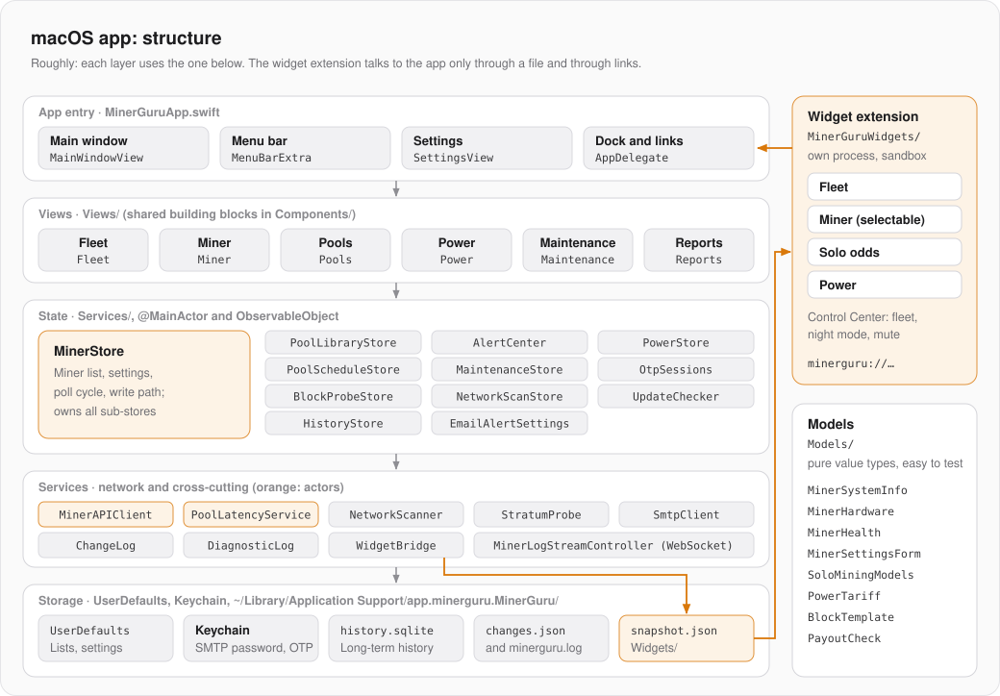

# macOS-App: Architektur

Was alle drei Apps gemeinsam haben (Miner-API, Abfragerunde, Schreibweg, Wächter, Mock-Miner), steht in [GRUNDLAGEN.md](GRUNDLAGEN.md). Diese Seite beschreibt nur die Mac-App.

| | |
|---|---|
| Sprache, Oberfläche | Swift 6 (strikte Nebenläufigkeit), SwiftUI, Swift Charts, ab macOS 14 |
| Bundle-ID | `app.minerguru.MinerGuru`, Mock-Build `app.minerguru.MinerGuru.mock` |
| Ziele | App `MinerGuru`, Widget-Erweiterung `MinerGuruWidgets`, Tests `MinerGuruTests` |
| Bauen | Xcode-Projekt mit synchronisierten Ordnern (neue Dateien landen automatisch im Ziel) oder `Package.swift` für `swift test` |
| Signatur | nur ad hoc, ohne Apple-Konto |

## Aufbau



| Ordner | Inhalt |
|---|---|
| `MinerGuru/MinerGuruApp.swift` | Einstieg: Szenen, Menüs, Tastenkürzel |
| `MinerGuru/Views/` | SwiftUI-Ansichten je Bereich, gemeinsame Bausteine in `Components/` (`Theme`, `DeviceCardView`, `PrivacyMode`) |
| `MinerGuru/Services/` | `MinerStore`, die Teil-Stores und die Dienste |
| `MinerGuru/Models/` | Werttypen ohne Oberfläche: Telemetrie, Hardware, Wächter-Logik, Tarife, Blockvorlage |
| `MinerGuru/Shared/` | Code, den App und Widget-Erweiterung beide kompilieren (`WidgetSnapshot`) |
| `MinerGuru/Support/` | Sprache, Zahlenformate, Logging, Dock, Spenden |
| `MinerGuruWidgets/` | Widgets und Schalter fürs Kontrollzentrum |
| `MinerGuruTests/` | Unit-Tests (Swift Testing und XCTest) |
| `MockMiners/` | simulierte Miner, siehe [GRUNDLAGEN.md](GRUNDLAGEN.md#testen-ohne-hardware) |
| `scripts/` | DMG, Release, Icon- und QR-Generatoren |
| `website/` | Produkt-Webseite für GitHub Pages |

## Einstieg und Fenster

`MinerGuruApp` legt drei Szenen an:

- **`Window("main")`** mit `MainWindowView`: Seitenleiste (Übersicht, Pools, Strom, Wartung, Berichte, je Miner eine Zeile) und Inhalt. Es gibt nur dieses eine Hauptfenster; ein zweites Öffnen holt es nach vorn.
- **`MenuBarExtra`** im Stil `.window`: Gesamt-Hashrate in der Menüleiste, ein Klick öffnet `MenuBarView`. Das Label lebt so lange wie die App und reicht deshalb `openWindow` an `WidgetBridge` und das Rechtsklick-Menü (`StatusItemMenu`) weiter.
- **`Window("Einstellungen")`** mit `SettingsView`.

`AppDelegate` sorgt dafür, dass das Schließen des Fensters die App nicht beendet: Sie läuft in der Menüleiste weiter, überwacht und führt Zeitpläne aus. `DockPresence` zeigt das Dock-Symbol nur, solange ein Fenster offen ist. Links mit `minerguru://` (von Widgets und Schaltern) kommen über `application(_:open:)` an. Jede Webseite kann solche Links öffnen. Darum gelten Schalt-Befehle (Nachtmodus, Alarme stumm) nur mit dem Schlüssel `commandKey`: Die App erzeugt ihn einmal, speichert ihn in den Einstellungen und schreibt ihn in den Widget-Stand, den nur Widgets und Schalter lesen (`WidgetCommand.accepted`). Öffnen-Links brauchen keinen Schlüssel.

## Zustand

`MinerStore` ist ein `@MainActor`-`ObservableObject` mit `@Published`-Eigenschaften und wird einmal in `MinerGuruApp` als `@StateObject` erzeugt. Er besitzt die Miner-Liste, die Einstellungen, die Abfrageschleife und den Schreibweg, und er erzeugt alle Teil-Stores:

| Teil-Store | Aufgabe |
|---|---|
| `PoolLibraryStore` | gespeicherte Pool-Konfigurationen |
| `AlertCenter` | Wächter, Warnungen, Stummschalten, Auszahlungsprüfung |
| `PowerStore` | Tarif, Strom-Zeitpläne, Nachtmodus, Kosten |
| `PoolScheduleStore` | zeitgesteuerte Pool-Wechsel |
| `MaintenanceStore` | Wartungsaufgaben und -einträge |
| `OtpSessions` | Einmalcode-Sitzungen je Miner |
| `BlockProbeStore` | Ergebnisse der Stratum-Abfrage |
| `NetworkScanStore` | Zustand des Subnetz-Scans |
| `UpdateChecker` | Update-Hinweis, einmal am Tag |
| `HistoryStore` | Langzeit-Verlauf in SQLite |
| `EmailAlertSettings` | E-Mail-Versand der Warnungen |

Für Tests nimmt `MinerStore.init` eine eigene `UserDefaults`-Suite und `startBackgroundWork: false`: Dann startet weder die Abfrage noch der Scan, und Schlüsselbund und Verlaufsdatei bleiben unberührt. Zusätzlich prüft `MinerGuruApp.isRunningTests`, ob die App nur als Test-Host läuft; dann schreibt sie keine Logs und fragt keine echten Miner ab.

## Nebenläufigkeit

- Die Netz-Clients `MinerAPIClient` und `PoolLatencyService` sind `actor`s mit eigener, flüchtiger `URLSession` (kurze Timeouts, kein Cache).
- `MinerStore.fetch` ist `nonisolated static` und läuft in einer `TaskGroup` für alle Miner parallel. Die Ergebnisse werden danach in einem Schritt auf dem MainActor übernommen.
- `ChangeLog.$source` ist ein `TaskLocal`: Zeitpläne und Wächter setzen ihn, damit das Änderungsprotokoll weiß, wer geschrieben hat.
- `HistoryStore`, `ChangeLog` und `DiagnosticLog` sind `@unchecked Sendable` und schützen ihren Zustand selbst (serielle Queue bzw. Lock).

## Speicher

| Wo | Was |
|---|---|
| `UserDefaults` | Miner-Liste, Pools, Strom, Zeitpläne, Warnungen, Wartung, Einstellungen. Alle Schlüssel heißen `MinerGuru.<Name>.v1`; ändert sich ein Format, bekommt der Schlüssel eine neue Nummer. |
| Schlüsselbund | SMTP-Passwort, Einmalcode-Sitzungen (Konto `otp.<Miner-ID>`) |
| `~/Library/Application Support/app.minerguru.MinerGuru/` | `history.sqlite`, `changes.json` (Änderungsprotokoll), `minerguru.log` (Diagnose, zwei Dateien im Wechsel), `Widgets/snapshot.json` |

## Widgets und Kontrollzentrum

- Widgets: Flotte (klein, mittel, groß), Miner (wählbar per `SelectMinerIntent`), Solo-Chance, Strom. Schalter im Kontrollzentrum (ab macOS 26): Flotte, Nachtmodus, Warnungen stumm.
- **Kein App Group.** macOS vergibt App Groups nur an Apps mit geprüfter Signatur, MinerGuru ist ad hoc signiert. Stattdessen schreibt `WidgetBridge` nach jeder Runde `Widgets/snapshot.json` in den Application-Support-Ordner der App, und die Erweiterung liest genau diesen Ordner über die Ausnahme `com.apple.security.temporary-exception.files.home-relative-path.read-only`. In der Sandbox muss der echte Home-Pfad über `getpwuid` bestimmt werden.
- Läuft die App nicht und ist der Schnappschuss älter als 10 min, fragt die Erweiterung die Miner selbst ab.
- Klicks und Schalter senden Links an die App: `open`, `open/miner/<id>`, `open/power`, `night/on|off`, `alerts/silence|resume` (`WidgetCommand`). Der Mock-Build nutzt das Schema `minerguru-mock`. Bundle-ID und Schema kommen aus den Build-Einstellungen `MINERGURU_BUNDLE_ID` und `MINERGURU_URL_SCHEME`.
- `make-dmg.sh` signiert erst die Erweiterung mit ihren eigenen Entitlements, dann die App, und zwar ohne `--deep` (sonst bekäme die Erweiterung die Entitlements der App).

## Bauen, testen, ausprobieren

```bash
open MinerGuru.xcodeproj
```

```bash
swift test
```

```bash
MockMiners/run-app-with-mocks.sh
```

```bash
MockMiners/run-app-with-mocks.sh hex nerdqx
```

`run-app-with-mocks.sh` startet die Mock-Miner und eine eigene App „MinerGuru (Mock)“ mit eigener Bundle-ID, die die echte Miner-Liste nicht anfasst. Im Debug-Build öffnet die Umgebungsvariable `MINERGURU_OPEN` (`pools`, `power`, `maintenance`, `reports`, `miner`) gleich die passende Seite.

Logs erscheinen in Console.app unter dem Subsystem `app.minerguru.MinerGuru`.

## Release

Die Version steht an zwei Stellen, die zusammenpassen müssen: `MinerGuru/Info.plist` und das Xcode-Ziel. Neue Funktion: mittlere Stelle erhöhen, Fehlerbehebung: letzte Stelle. Danach `swift test` und `scripts/release.sh`. Details in [RELEASE.md](RELEASE.md).

## Stolperstellen

- Neue Texte übernimmt Xcode beim Bauen in `Localizable.xcstrings`; die englische Übersetzung muss man dort selbst eintragen.
- Jede neue Ad-hoc-Signatur ändert den Code-Hash. Freigaben des Systems, die an den Code gebunden sind, passen danach nicht mehr und werden neu erfragt.
- Mock-App und echte App gleichzeitig installiert: Die Widget-Galerie zeigt dann jedes Widget doppelt.
- Ein Schreibvorgang an `MinerAPIClient` vorbei taucht nicht im Änderungsprotokoll auf und ignoriert den Nur-Lesen-Modus. Neue Schreibwege immer über den Client.
- Ein ungestrippter Release-Build trägt in der Debug-Map über 200 Build-Pfade mit dem Benutzernamen. `make-dmg.sh` baut deshalb mit `DEPLOYMENT_POSTPROCESSING=YES` und Strip. `strings` übersieht diese Pfade in Universal-Binaries; die Spurenprüfung sucht daher mit `grep -a` in den Rohbytes, zuletzt im fertigen DMG. Dessen `.DS_Store` merkt sich, wo das beschreibbare Image lag, darum entsteht es unter `/private/tmp/MinerGuru-dmg`.
- Ein MacBook wacht auch zugeklappt etwa alle 15–20 Minuten kurz auf (Power Nap). Dann fehlt das Netz für ein paar Sekunden, und eine Anfrage von vor dem Schlaf läuft beim Aufwachen in den Timeout. `WakeGrace` erkennt den Schlaf am Abstand zwischen `ContinuousClock` (läuft im Schlaf weiter) und `SuspendingClock` (steht). Bis 30 s danach behält ein Miner ohne Antwort seinen letzten Zustand und zählt weder im Verlauf noch bei den Wächtern. Im Diagnose-Log steht dann `wake after sleep=…` und `no answer right after wake, not counted`.
