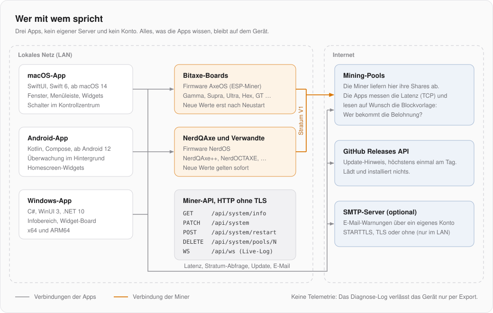
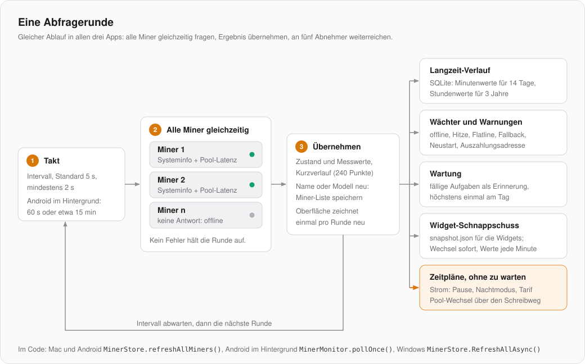
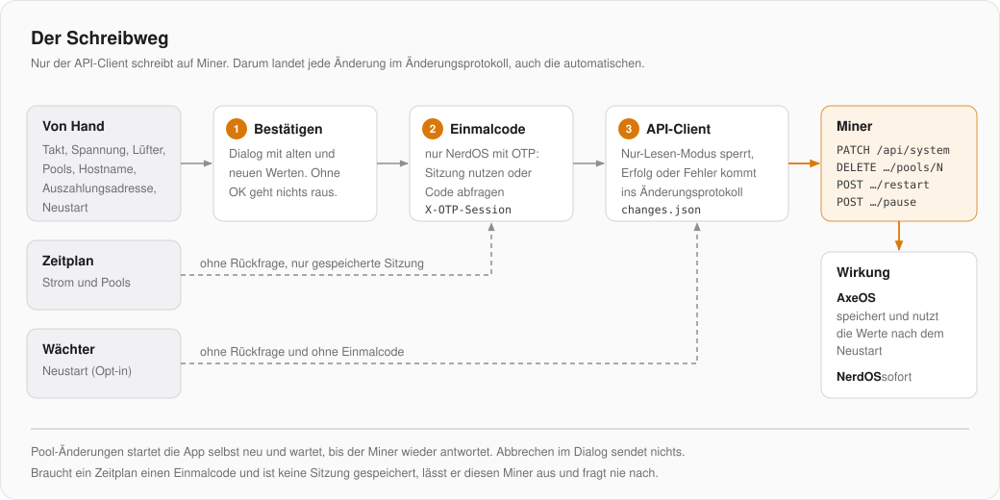

# MinerGuru: fundamentals for developers

MinerGuru exists three times: for macOS, Android and Windows. Each app is native, written in its platform's language, and has its own repository; they share no code. They do follow the same blueprint, speak the same miner API and name their parts the same way. This page describes everything the three apps have in common. What concerns only one app is in that app's architecture doc.

| App | Repository | Language and UI | Architecture |
|---|---|---|---|
| macOS | [minerguru](https://github.com/GuruMeditationSoftware/minerguru) | Swift 6, SwiftUI, macOS 14+ | [docs/ARCHITECTURE.md](ARCHITECTURE.md) |
| Android | [minerguru-android](https://github.com/GuruMeditationSoftware/minerguru-android) | Kotlin, Jetpack Compose, Android 12+ | [docs/ARCHITECTURE.md](https://github.com/GuruMeditationSoftware/minerguru-android/blob/main/docs/ARCHITECTURE.md) |
| Windows | [minerguru-windows](https://github.com/GuruMeditationSoftware/minerguru-windows) | C#, WinUI 3, .NET 10 | [docs/ARCHITECTURE.md](https://github.com/GuruMeditationSoftware/minerguru-windows/blob/main/docs/ARCHITECTURE.md) |

The mock miners live only here in the Mac repository; the other apps use them from here. If you work on all three, put the repositories side by side in one folder, with the Mac repository named `MinerGuru`: the Windows scripts look for the mock miners in `../MinerGuru/MockMiners`.

**The Mac app is the reference.** New features usually appear on the Mac first and are then ported to Android and Windows. To port a feature, read the Mac code and look up the matching class in the [counterparts](#counterparts-in-the-three-apps) table.

## System overview

- There is no MinerGuru server and no account. Everything an app knows stays on the device.
- The apps talk to the miners on the local network over HTTP (without TLS, which is what the miners offer).
- Only these go to the internet: the TCP latency measurement and the optional Stratum probe to the pools, the GitHub Releases API once a day for the update notice and, if set up, emails through an SMTP server.
- The diagnostic log leaves the device only when someone exports it. It contains no passwords, wallet addresses, pool users, one-time codes or names.

## The miner API

MinerGuru knows two firmware families. Both share the same REST API but behave differently:

| | AxeOS (ESP-Miner) | NerdOS |
|---|---|---|
| Devices | all Bitaxe boards (Gamma, Supra, Ultra, Hex, GT, …) | NerdQAxe++, NerdQAxe+, NerdOCTAXE, NerdAxe, … |
| Detection | reports `boardVersion`; board family from the table in ESP-Miner's `device_config.h` | reports `deviceModel`, no `boardVersion` |
| New settings | saved, active only after a restart | active at once |
| Pools | from 2.15 up to 8 slots with freely chosen primary and fallback slot, slots can be deleted | primary and fallback, on the NerdQAxe also dual pool with a hashrate split |
| Pause and resume | from 2.15 | no |
| Current block | from 2.13 the miner reports it itself | no, the Stratum probe fills in |
| One-time code (OTP) | no | optional; writes then need a session in the `X-OTP-Session` header |

The endpoints:

| Method | Path | Purpose |
|---|---|---|
| `GET` | `/api/system/info` | Telemetry, settings, pools. Each poll cycle reads only this. |
| `PATCH` | `/api/system` | Write settings (clock, voltage, fan, pools, hostname) |
| `POST` | `/api/system/restart` | Restart |
| `POST` | `/api/system/pause`, `/api/system/resume` | Stop and resume hashing (AxeOS 2.15+) |
| `DELETE` | `/api/system/pools/N` | Clear a pool slot (AxeOS 2.15+; the miner refuses the primary and fallback slot) |
| WebSocket | `/api/ws` | Live log; the app also reads the difficulty of every share from it |

The responses are not uniform: depending on the firmware version, fields are missing, have other names or arrive as text instead of numbers. All three apps therefore decode `MinerSystemInfo` leniently. An unknown field must never make a miner count as offline.

## A poll cycle

1. **Tick:** The app polls at the set interval (default 5 s, at least 2 s). Android polls less often in the background, see the Android docs.
2. **All miners at once:** per miner `GET /api/system/info` and a TCP handshake measurement to its pools. An error becomes the state "offline" with a reason; it never aborts the cycle.
3. **Apply:** All results are written into the miner list in one step, so the UI redraws only once per cycle. Each miner keeps a short history of 240 points for the live charts. If the hostname or model changed, the saved miner list is updated.
4. **Consumers:** Then the long-term history, the watchdog, maintenance and the widget snapshot get the result, one after the other. The power and pool schedules run in the background without waiting, so that restarting a miner does not hold up the next cycle.

## The write path

- The API client is the **only** place that writes to a miner. It checks read-only mode (a setting), records every attempt with its result in the change log (`changes.json`) and writes only the field names to the diagnostic log, never the values.
- The change log records who triggered the write: by hand, a schedule or the watchdog.
- Changes made by hand show a dialog with old and new values first. The old values come from the last `/api/system/info` response.
- Schedules never ask. If a miner needs a one-time code and no valid session is stored, the schedule skips it.
- After a pool change the app restarts the miner itself, because AxeOS only uses the new pools after a restart. It waits until the miner answers again and then reads the configuration it actually uses.

## Watchdog and alerts

The watchdog (`AlertCenter` with `MinerHealth`) evaluates every cycle. Most alerts need several cycles, so a single dropout raises no alarm.

| Kind | When |
|---|---|
| offline / back online | three failed attempts and at least 90 s without an answer |
| Overheating | AxeOS reports it itself; on NerdOS three cycles in a row just below its own limit |
| Flatline | the miner answers and draws power, but no shares arrive and the averages freeze |
| Fallback pool | on the fallback for more than 10 min |
| Unexpected restart | uptime jumps back without MinerGuru having triggered a restart |
| Payout address | a pool slot pays to a foreign address or to a factory entry |
| Maintenance due | a maintenance task is due, reminder at most once a day |

- The same alert repeats after 30 min at the earliest. Several alerts at the same time are merged into one message.
- Alerts can be muted per miner and per kind, or paused until the next morning (7 am).
- Delivery as a system notification and, if set up, also by email.
- Optionally (off by default) the watchdog restarts a miner itself: on a flatline at most once an hour, and when it stays stuck on the fallback pool although the primary pool answers.

## Long-term history

Each app writes every cycle into a local SQLite file `history.sqlite`: first as one-minute averages, kept for 14 days, then condensed into hourly values, kept for 3 years. The long-term charts, the reports (CSV and PDF) and the 24-hour line of the widgets come from it.

## Widgets

All three apps have widgets, and all solve the problem the same way: after every cycle the app writes a file `snapshot.json`, and the widget process reads it. If the file is too old because the app is not running (Mac and Android after 10 min, Windows after 90 s), the widget process polls the miners itself. Tapping a widget opens the app at the matching place.

| | macOS | Android | Windows |
|---|---|---|---|
| Widget process | widget extension `MinerGuruWidgets` | `AppWidgetProvider` with RemoteViews | the same exe with `-widgetprovider` (COM) |
| Snapshot | `~/Library/Application Support/<bundle ID>/Widgets/` | `files/widgets/` | `%LOCALAPPDATA%\MinerGuru\widgets\` |
| Back into the app | `minerguru://…`, switch commands only with the `commandKey` from the widget snapshot | intent extra `app.minerguru.route` (navigation only) | `minerguru://open` (opening only) |
| Special | also controls in Control Center | Material You colors, a neutral card on Samsung | Developer Mode only, opt-in in the settings |

Widgets and controls redraw at once when a state changes, otherwise at most once a minute. Faster would use up WidgetKit's reload budget on the Mac.

## Privacy and anonymity

- **Private mode** (eye symbol): IP, wallet and MAC addresses, the Wi-Fi name and the subnet are replaced by gibberish of the same shape, input fields are blurred. Worker names stay readable. Meant for screenshots.
- **Secrets** (SMTP password, one-time code sessions) live in the platform's key store: Keychain (Mac), Android Keystore, DPAPI (Windows).
- **Publishing anonymously:** no name, user name, personal domain or email address in code, package names, binaries or certificates. Before packaging, the release scripts search for such traces and abort; the search patterns live outside the repositories (`MINERGURU_TRACES`, otherwise `~/.config/minerguru/traces`). Nothing is signed except ad hoc (Mac) and with the project's own key `CN=MinerGuru` (Android).

## Language

English is the source language, German the translation. All three apps keep their texts in the platform's resource files; the code only names the key. Without a choice in the settings the app starts in German on a German system, otherwise in English, which is also the fallback for every other language.

| macOS | Android | Windows |
|---|---|---|
| `Localizable.xcstrings`, source language English. The key is the English text: `Text("Fleet")`, `String(localized: "Fleet")`. Xcode picks up new strings when building; enter the German in the catalog editor | `res/values/strings.xml` (English) and `res/values-de/strings.xml` (German): `tr(R.string.fleet)`, `tr(R.string.miner_added, name)` with `%1$s`, `trp(R.plurals.pools, n)` for counts | `src/MinerGuru.Core/Resources/Strings.resx` (English) and `Strings.de.resx` (German). The build generates `Strings` with one property per key: `Strings.Fleet`, `string.Format(Strings.MinerAdded, name)` with `{0}`, in XAML `{local:T Key=Fleet}` |

One English word with two German meanings needs two keys. The Power page is "Strom" in German, the power figure "Leistung", both "Power" in English: on the Mac the page uses the key `Power (section)`, whose English value in the catalog is `Power`; on Android and Windows the keys differ anyway (`power_page`, `PowerPage`).

## Testing without hardware

`MockMiners/` (here in the Mac repository) simulates every known variant:

- `mock_miner.py` starts one server per variant from port 48001 that behaves like the firmware: AxeOS applies settings after a restart, NerdOS at once, a restart makes the miner unreachable for a moment, live log over WebSocket. Every request shows up with its body in the terminal. `--host 0.0.0.0` makes the mocks reachable for the Windows VM.
- `variants/` holds 24 responses of `/api/system/info`, generated by `make_variants.py` from two anonymized real responses and the firmware's board tables.
- `stratum-captures/` are recorded responses of real pools. Mocks without block data of their own point to local Stratum servers that replay them, so the Stratum probe has something to read.
- `mock_smtp.py` accepts emails and shows them.
- New variant: add an entry to `make_variants.py`, run the script, add the expectation to the `VariantTests` of all three apps. Android copies the variants into its test resources, Windows uses a selection as fixtures.

## Counterparts in the three apps

| Task | macOS | Android | Windows |
|---|---|---|---|
| Miner list, poll cycle, settings | `MinerStore` | `MinerStore` (ViewModel), in the background `MinerMonitor` | `MinerStore` (Core) |
| HTTP to the miner | `MinerAPIClient` (actor, URLSession) | `MinerApiClient` (OkHttp) | `MinerApiClient` (HttpClient) |
| Telemetry model | `MinerSystemInfo` | `MinerSystemInfo` | `MinerSystemInfo` |
| Hardware detection | `MinerHardware` | `MinerHardware` | `MinerHardware` |
| Pool latency | `PoolLatencyService` | `PoolLatencyService` | in `MinerApiClient` |
| Network scan | `NetworkScanner`, `NetworkScanStore` | `NetworkScanner`, state in `MinerStore` | `NetworkScanner`, `NetworkScanStore` |
| Watchdog, alerts | `AlertCenter`, `MinerHealth` | `AlertCenter`, `AlertEvaluator`, `MinerHealth` | `AlertCenter`, `MinerHealth` |
| Email | `EmailAlertSettings`, `SmtpClient` | `EmailAlerts`, `SmtpClient` | `EmailAlerts`, `SmtpClient` |
| Long-term history | `HistoryStore` | `HistoryRecorder` | `HistoryStore` |
| Power and tariff | `PowerStore`, `PowerTariff` | `PowerCenter`, `PowerTariff` | `PowerStore`, `PowerTariff` |
| Pool library | `PoolLibraryStore` | in `MinerStore` | `PoolLibrary` |
| Pool schedules | `PoolScheduleStore` | `PoolScheduleCenter` | `PoolScheduleStore` |
| Maintenance | `MaintenanceStore` | `MaintenanceCenter` | `MaintenanceStore` |
| One-time codes | `OtpSessions` | `OtpSessions`, `OtpCenter` | `OtpSessions` |
| Stratum probe, block template | `StratumProbe`, `BlockProbeStore` | `StratumProbe`, `BlockProbeStore` | `StratumProbe`, `BlockProbeStore` |
| Payout check | `PayoutCheck`, `CoinAddress` | `PayoutCheck`, `CoinAddress` | `PayoutCheck`, `CoinAddress` |
| Live log | `MinerLogStreamController` | `MinerLogStream` | `MinerLogStream` |
| Change log | `ChangeLog` | `ChangeLog` | `ChangeLog` |
| Diagnostic log | `DiagnosticLog` | `DiagnosticLog` | `DiagnosticLog` |
| Widgets | `WidgetBridge`, `WidgetSnapshot` | `WidgetBridge`, `WidgetSnapshot` | `WidgetSnapshot`, `WidgetCards`, `WidgetService` |
| Update notice | `UpdateChecker` | `UpdateChecker` | `UpdateChecker` |
| Private mode | `PrivacyMode`, `Redactor` | `Privacy` | `Privacy` |
| Unit tests | `swift test` | `./gradlew testDebugUnitTest` | `scripts/vm.sh test` |

## Bringing a feature to all three apps

1. Build it on the Mac, check it with unit tests and against the mock miners. If a firmware behavior is missing from the mock, extend the mock first.
2. Port it to Android: the same names, the same limits, the same tests.
3. Port it to Windows; anything testable belongs in `MinerGuru.Core`.
4. Strings in both languages, private mode for new addresses and names, new writes only through the API client.
5. Raise the version of each app and release it: [RELEASE.md](RELEASE.md) for the Mac, `scripts/release.sh` in every repository. The maintainer uploads to the GitHub releases.
