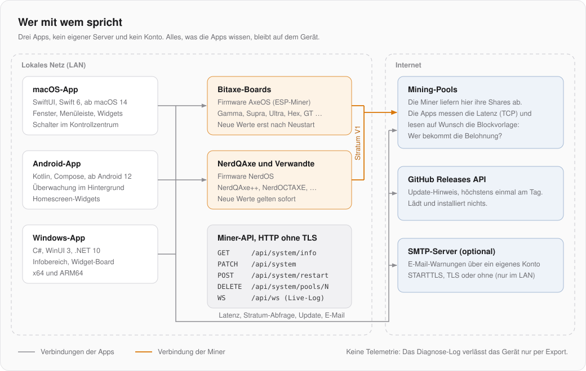
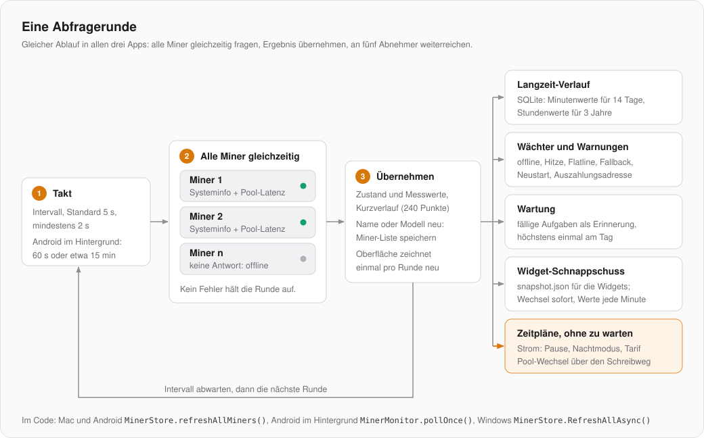
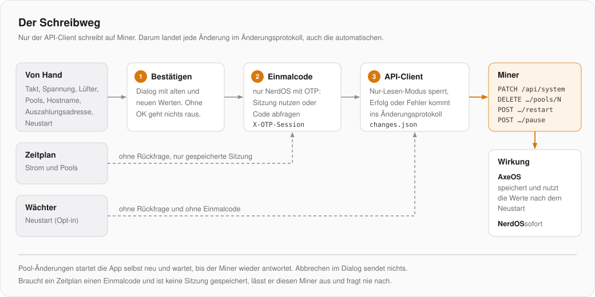

# MinerGuru: Grundlagen für Entwickler

MinerGuru gibt es dreimal: für macOS, Android und Windows. Jede App ist nativ in der Sprache ihrer Plattform geschrieben und hat ein eigenes Repository; Code teilen sie nicht. Sie folgen aber demselben Bauplan, sprechen dieselbe Miner-API und benennen ihre Teile gleich. Diese Seite beschreibt alles, was in allen drei Apps gleich ist. Was nur eine App betrifft, steht in ihrer eigenen Architektur-Doku.

| App | Repository | Sprache und Oberfläche | Architektur |
|---|---|---|---|
| macOS | [minerguru](https://github.com/GuruMeditationSoftware/minerguru) | Swift 6, SwiftUI, ab macOS 14 | [docs/ARCHITEKTUR.md](ARCHITEKTUR.md) |
| Android | [minerguru-android](https://github.com/GuruMeditationSoftware/minerguru-android) | Kotlin, Jetpack Compose, ab Android 12 | [docs/ARCHITEKTUR.md](https://github.com/GuruMeditationSoftware/minerguru-android/blob/main/docs/ARCHITEKTUR.md) |
| Windows | [minerguru-windows](https://github.com/GuruMeditationSoftware/minerguru-windows) | C#, WinUI 3, .NET 10 | [docs/ARCHITEKTUR.md](https://github.com/GuruMeditationSoftware/minerguru-windows/blob/main/docs/ARCHITEKTUR.md) |

Die Mock-Miner leben nur hier im Mac-Repo, die anderen Apps nutzen sie von dort. Wer alle drei bearbeitet, legt die Repos nebeneinander in einen Ordner, das Mac-Repo unter dem Namen `MinerGuru`: Die Windows-Skripte suchen die Mock-Miner unter `../MinerGuru/MockMiners`.

**Die Mac-App ist die Referenz.** Neue Funktionen entstehen meist zuerst auf dem Mac und werden danach nach Android und Windows übertragen. Wer eine Funktion portiert, liest den Mac-Code und sucht in der Tabelle [Gegenstücke](#gegenstücke-in-den-drei-apps) die passende Klasse.

## Systemüberblick

- Es gibt keinen MinerGuru-Server und kein Konto. Alles, was eine App weiß, liegt auf dem Gerät.
- Die Apps sprechen per HTTP (ohne TLS, so bieten es die Miner an) mit den Minern im lokalen Netz.
- Ins Internet gehen nur: die TCP-Latenzmessung und die optionale Stratum-Abfrage zu den Pools, einmal am Tag die GitHub-Releases-API für den Update-Hinweis und, falls eingerichtet, E-Mails über einen SMTP-Server.
- Das Diagnose-Log verlässt das Gerät nur, wenn jemand es exportiert. Es enthält keine Passwörter, Wallet-Adressen, Pool-Benutzer, Einmalcodes oder Namen.

## Die Miner-API

MinerGuru kennt zwei Firmware-Familien. Beide haben dieselbe REST-API, verhalten sich aber unterschiedlich:

| | AxeOS (ESP-Miner) | NerdOS |
|---|---|---|
| Geräte | alle Bitaxe-Boards (Gamma, Supra, Ultra, Hex, GT, …) | NerdQAxe++, NerdQAxe+, NerdOCTAXE, NerdAxe, … |
| Erkennung | meldet `boardVersion`; Board-Familie aus der Tabelle in ESP-Miners `device_config.h` | meldet `deviceModel`, kein `boardVersion` |
| Neue Einstellungen | gespeichert, aktiv erst nach Neustart | sofort aktiv |
| Pools | ab 2.15 bis zu 8 Slots mit frei wählbarem Primär- und Fallback-Slot, Slots löschbar | Primär und Fallback, beim NerdQAxe auch Dual-Pool mit Aufteilung der Hashrate |
| Pause und Fortsetzen | ab 2.15 | nein |
| Aktueller Block | ab 2.13 meldet der Miner ihn selbst | nein, dafür gibt es die Stratum-Abfrage |
| Einmalcode (OTP) | nein | optional; Schreiben braucht dann eine Sitzung im Header `X-OTP-Session` |

Die Endpunkte:

| Methode | Pfad | Wofür |
|---|---|---|
| `GET` | `/api/system/info` | Telemetrie, Einstellungen, Pools. Jede Abfragerunde liest nur das. |
| `PATCH` | `/api/system` | Einstellungen schreiben (Takt, Spannung, Lüfter, Pools, Hostname) |
| `POST` | `/api/system/restart` | Neustart |
| `POST` | `/api/system/pause`, `/api/system/resume` | Hashing anhalten und fortsetzen (AxeOS 2.15+) |
| `DELETE` | `/api/system/pools/N` | Pool-Slot leeren (AxeOS 2.15+; Primär- und Fallback-Slot verweigert der Miner) |
| WebSocket | `/api/ws` | Live-Log; daraus liest die App auch die Difficulty jedes Shares |

Die Antworten sind nicht einheitlich: Felder fehlen je nach Firmware-Version, heißen anders oder kommen als Text statt als Zahl. Alle drei Apps decodieren `MinerSystemInfo` deshalb tolerant. Ein unbekanntes Feld darf nie dazu führen, dass ein Miner als offline gilt.

## Eine Abfragerunde

1. **Takt:** Die App fragt im eingestellten Intervall (Standard 5 s, mindestens 2 s). Android fragt im Hintergrund seltener, siehe Android-Doku.
2. **Alle Miner gleichzeitig:** je Miner `GET /api/system/info` und eine TCP-Handshake-Messung zu seinen Pools. Ein Fehler wird zum Zustand „offline“ mit Grund; er bricht die Runde nie ab.
3. **Übernehmen:** Alle Ergebnisse werden in einem Schritt in die Miner-Liste geschrieben, damit die Oberfläche nur einmal pro Runde neu zeichnet. Jeder Miner behält einen Kurzverlauf von 240 Punkten für die Live-Charts. Hat sich Hostname oder Modell geändert, wird die gespeicherte Miner-Liste aktualisiert.
4. **Abnehmer:** Danach bekommen nacheinander der Langzeit-Verlauf, die Wächter, die Wartung und der Widget-Schnappschuss das Ergebnis. Die Zeitpläne für Strom und Pools laufen ohne zu warten im Hintergrund, damit der Neustart eines Miners die nächste Runde nicht aufhält.

## Der Schreibweg

- Der API-Client ist die **einzige** Stelle, die auf einen Miner schreibt. Er prüft den Nur-Lesen-Modus (Einstellung), schreibt jeden Versuch mit Ergebnis ins Änderungsprotokoll (`changes.json`) und nur die Feldnamen ins Diagnose-Log, nie die Werte.
- Wer den Schreibvorgang ausgelöst hat, steht im Protokoll: von Hand, Zeitplan oder Wächter.
- Von Hand ausgelöste Änderungen zeigen vorher einen Dialog mit alten und neuen Werten. Die alten Werte stammen aus der letzten Antwort von `/api/system/info`.
- Zeitpläne fragen nie nach. Braucht ein Miner einen Einmalcode und ist keine gültige Sitzung gespeichert, lässt der Zeitplan ihn aus.
- Pool-Änderungen startet die App selbst neu, weil AxeOS sie erst danach nutzt. Sie wartet, bis der Miner wieder antwortet, und liest dann die Konfiguration, die er wirklich verwendet.

## Wächter und Warnungen

Der Wächter (`AlertCenter` mit `MinerHealth`) bewertet jede Runde. Die meisten Warnungen brauchen mehrere Runden, damit ein einzelner Aussetzer keinen Alarm auslöst.

| Art | Wann |
|---|---|
| offline / wieder online | drei Fehlversuche und mindestens 90 s ohne Antwort |
| Überhitzung | AxeOS meldet sie selbst; bei NerdOS drei Runden in Folge kurz vor dessen eigenem Limit |
| Flatline | Miner antwortet und zieht Strom, aber es kommen keine Shares mehr und die Mittelwerte frieren ein |
| Fallback-Pool | länger als 10 min auf dem Fallback |
| Unerwarteter Neustart | Laufzeit springt zurück, ohne dass MinerGuru den Neustart ausgelöst hat |
| Auszahlungsadresse | ein Pool-Slot zahlt an eine fremde Adresse oder an einen Werkseintrag |
| Wartung fällig | eine Wartungsaufgabe ist fällig, Erinnerung höchstens einmal am Tag |

- Dieselbe Warnung wiederholt sich frühestens nach 30 min. Mehrere gleichzeitige Warnungen werden zu einer Meldung zusammengefasst.
- Warnungen lassen sich je Miner und je Art stummschalten oder bis zum nächsten Morgen (7 Uhr) pausieren.
- Zustellung als Mitteilung des Systems und, falls eingerichtet, zusätzlich per E-Mail.
- Optional (aus bei Auslieferung) startet der Wächter einen Miner selbst neu: bei Flatline höchstens einmal pro Stunde, und wenn er auf dem Fallback-Pool hängen bleibt, obwohl der Primär-Pool antwortet.

## Langzeit-Verlauf

Jede App schreibt jede Runde in eine lokale SQLite-Datei `history.sqlite`: erst als Minutenmittel, die 14 Tage bleiben, dann zusammengefasst zu Stundenwerten, die 3 Jahre bleiben. Daraus entstehen die Langzeit-Charts, die Berichte (CSV und PDF) und die 24-Stunden-Linie der Widgets.

## Widgets

Alle drei Apps haben Widgets, und alle lösen das Problem gleich: Die App schreibt nach jeder Runde eine Datei `snapshot.json`, der Widget-Prozess liest sie. Ist die Datei zu alt, weil die App nicht läuft (Mac und Android nach 10 min, Windows nach 90 s), fragt der Widget-Prozess die Miner selbst. Ein Tipp aufs Widget öffnet die App an der passenden Stelle.

| | macOS | Android | Windows |
|---|---|---|---|
| Widget-Prozess | Widget-Erweiterung `MinerGuruWidgets` | `AppWidgetProvider` mit RemoteViews | dieselbe exe mit `-widgetprovider` (COM) |
| Schnappschuss | `~/Library/Application Support/<Bundle-ID>/Widgets/` | `files/widgets/` | `%LOCALAPPDATA%\MinerGuru\widgets\` |
| Zurück in die App | `minerguru://…`, Schalt-Befehle nur mit `commandKey` aus dem Widget-Stand | Intent-Extra `app.minerguru.route` (nur Navigation) | `minerguru://open` (nur Öffnen) |
| Besonderheit | auch Schalter im Kontrollzentrum | Material-You-Farben, auf Samsung neutrale Karte | nur mit Entwicklermodus, Opt-in in den Einstellungen |

Widgets und Schalter zeichnen bei einem Zustandswechsel sofort neu, sonst höchstens einmal pro Minute. Schneller würde auf dem Mac das Reload-Budget von WidgetKit aufbrauchen.

## Datenschutz und Anonymität

- **Privatmodus** (Augen-Symbol): IP-, Wallet- und MAC-Adressen, WLAN-Name und Subnetz werden durch Zeichensalat gleicher Form ersetzt, Eingabefelder weichgezeichnet. Worker-Namen bleiben lesbar. Gedacht für Screenshots.
- **Geheimnisse** (SMTP-Passwort, Einmalcode-Sitzungen) liegen im Schlüsselspeicher der Plattform: Schlüsselbund (Mac), Android Keystore, DPAPI (Windows).
- **Anonym veröffentlichen:** Kein Name, kein Benutzername, keine persönliche Domain oder Mail-Adresse in Code, Paketnamen, Binärdateien oder Zertifikaten. Die Release-Skripte suchen vor dem Packen nach solchen Spuren und brechen ab; die Suchmuster liegen außerhalb der Repos (`MINERGURU_TRACES`, sonst `~/.config/minerguru/traces`). Signiert wird nichts außer ad hoc (Mac) und mit dem eigenen Schlüssel `CN=MinerGuru` (Android).

## Sprache

Deutsch ist die Quellsprache, Englisch die Übersetzung. Ohne Wahl in den Einstellungen startet die App auf einem deutschen System auf Deutsch, sonst auf Englisch.

| macOS | Android | Windows |
|---|---|---|
| `Localizable.xcstrings`; Xcode übernimmt neue Texte beim Bauen, Englisch im Katalog-Editor eintragen | `L("deutsch", "english")` direkt im Code, `Lp(…)` für Mehrzahl | `L(de, en)` im Code, `{local:T De=…, En=…}` in XAML |

## Testen ohne Hardware

`MockMiners/` (hier im Mac-Repo) simuliert jede bekannte Variante:

- `mock_miner.py` startet je Variante einen Server ab Port 48001, der sich verhält wie die Firmware: AxeOS übernimmt Einstellungen nach dem Neustart, NerdOS sofort, Neustart macht den Miner kurz unerreichbar, Live-Log per WebSocket. Jede Anfrage erscheint mit Inhalt im Terminal. `--host 0.0.0.0` macht die Mocks für die Windows-VM erreichbar.
- `variants/` enthält 24 Antworten von `/api/system/info`, erzeugt von `make_variants.py` aus zwei anonymisierten echten Antworten und den Board-Tabellen der Firmware.
- `stratum-captures/` sind aufgezeichnete Antworten echter Pools. Mocks ohne eigene Blockdaten zeigen auf lokale Stratum-Server, die sie abspielen, damit die Stratum-Abfrage etwas zu lesen hat.
- `mock_smtp.py` nimmt E-Mails an und zeigt sie an.
- Neue Variante: Eintrag in `make_variants.py`, Skript ausführen, Erwartung in den `VariantTests` aller drei Apps nachtragen. Android kopiert die Varianten in seine Test-Ressourcen, Windows nutzt eine Auswahl als Fixtures.

## Gegenstücke in den drei Apps

| Aufgabe | macOS | Android | Windows |
|---|---|---|---|
| Miner-Liste, Abfragerunde, Einstellungen | `MinerStore` | `MinerStore` (ViewModel), im Hintergrund `MinerMonitor` | `MinerStore` (Core) |
| HTTP zum Miner | `MinerAPIClient` (actor, URLSession) | `MinerApiClient` (OkHttp) | `MinerApiClient` (HttpClient) |
| Telemetrie-Modell | `MinerSystemInfo` | `MinerSystemInfo` | `MinerSystemInfo` |
| Hardware-Erkennung | `MinerHardware` | `MinerHardware` | `MinerHardware` |
| Pool-Latenz | `PoolLatencyService` | `PoolLatencyService` | im `MinerApiClient` |
| Netzwerk-Scan | `NetworkScanner`, `NetworkScanStore` | `NetworkScanner`, Zustand im `MinerStore` | `NetworkScanner`, `NetworkScanStore` |
| Wächter, Warnungen | `AlertCenter`, `MinerHealth` | `AlertCenter`, `AlertEvaluator`, `MinerHealth` | `AlertCenter`, `MinerHealth` |
| E-Mail | `EmailAlertSettings`, `SmtpClient` | `EmailAlerts`, `SmtpClient` | `EmailAlerts`, `SmtpClient` |
| Langzeit-Verlauf | `HistoryStore` | `HistoryRecorder` | `HistoryStore` |
| Strom und Tarif | `PowerStore`, `PowerTariff` | `PowerCenter`, `PowerTariff` | `PowerStore`, `PowerTariff` |
| Pool-Bibliothek | `PoolLibraryStore` | im `MinerStore` | `PoolLibrary` |
| Pool-Zeitpläne | `PoolScheduleStore` | `PoolScheduleCenter` | `PoolScheduleStore` |
| Wartung | `MaintenanceStore` | `MaintenanceCenter` | `MaintenanceStore` |
| Einmalcodes | `OtpSessions` | `OtpSessions`, `OtpCenter` | `OtpSessions` |
| Stratum-Abfrage, Blockvorlage | `StratumProbe`, `BlockProbeStore` | `StratumProbe`, `BlockProbeStore` | `StratumProbe`, `BlockProbeStore` |
| Auszahlungsprüfung | `PayoutCheck`, `CoinAddress` | `PayoutCheck`, `CoinAddress` | `PayoutCheck`, `CoinAddress` |
| Live-Log | `MinerLogStreamController` | `MinerLogStream` | `MinerLogStream` |
| Änderungsprotokoll | `ChangeLog` | `ChangeLog` | `ChangeLog` |
| Diagnose-Log | `DiagnosticLog` | `DiagnosticLog` | `DiagnosticLog` |
| Widgets | `WidgetBridge`, `WidgetSnapshot` | `WidgetBridge`, `WidgetSnapshot` | `WidgetSnapshot`, `WidgetCards`, `WidgetService` |
| Update-Hinweis | `UpdateChecker` | `UpdateChecker` | `UpdateChecker` |
| Privatmodus | `PrivacyMode`, `Redactor` | `Privacy` | `Privacy` |
| Unit-Tests | `swift test` | `./gradlew testDebugUnitTest` | `scripts/vm.sh test` |

## Eine Funktion in alle drei Apps bringen

1. Auf dem Mac bauen, mit Unit-Tests und gegen die Mock-Miner prüfen. Fehlt ein Firmware-Verhalten im Mock, zuerst den Mock erweitern.
2. Nach Android übertragen: dieselben Namen, dieselben Grenzwerte, dieselben Tests.
3. Nach Windows übertragen; Testbares gehört nach `MinerGuru.Core`.
4. Texte in beiden Sprachen, Privatmodus für neue Adressen und Namen bedenken, neue Schreibvorgänge nur über den API-Client.
5. Version je App anheben und releasen: [RELEASE.md](RELEASE.md) für den Mac, `scripts/release.sh` in jedem Repo. Den Upload in die GitHub-Releases macht der Maintainer.
